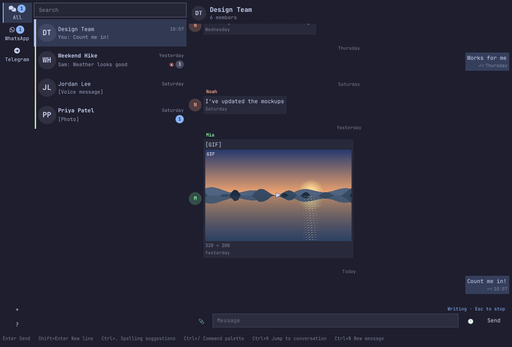

# OmaMessenger

A keyboard-first messaging client for [Omarchy](https://omarchy.org), for Telegram and WhatsApp accounts.



OmaMessenger is an Omarchy plugin. The window runs inside `omarchy-shell`, and Hyprland manages it like any other app; a Go helper it starts handles the messaging underneath.

> **Unofficial clients.** OmaMessenger is not made or endorsed by Telegram or WhatsApp. WhatsApp support uses an unofficial library, and WhatsApp may restrict or ban an account that uses one; Telegram can rate-limit or restrict accounts too. Consider trying it with an account you could afford to lose first. See [docs/privacy.md](docs/privacy.md).

Short clips of each feature are in [docs/demo.md](docs/demo.md).

## Features

- One conversation list across every Telegram and WhatsApp account, filtered by service from the rail; give an account its own name, such as "Personal WhatsApp", once you have more than one for a service
- Keyboard-first: every action has a shortcut, and **Ctrl+/** lists them all
- Search across every conversation with **Ctrl+K**, and an unread view with **Ctrl+Shift+A**
- Photos, video, GIFs, files, voice notes, link previews, replies, reactions, polls and @-mentions; a photo, video or GIF opens full size, and copy, save or open with **c**, **s** or **x**
- Edit or delete your own sent messages (**↑** in an empty message box, or **E** on a highlighted one, to edit)
- English spell check in the composer, with a picker for suggestions, adding a word, or ignoring it for the session
- Pin any number of conversations and reorder them by dragging or with **Ctrl+Shift+↑ / ↓**; archive, hide, snooze and mark conversations read or unread; failed sends retry themselves; block a contact or report spam from the command palette
- Received photos, videos, voice notes and files are re-encoded by OmaMessenger before the window shows them - video and audio inside a sandbox with no network - and size-checked throughout, with a confirmation first for a file that could run code or a link whose real destination does not match its own text
- The composer shows the open chat's own attachment limit and refuses a file over it before sending: up to 2 GB for a file (4 GB with Telegram Premium), or 16 MB for a photo or video sent on WhatsApp
- Desktop notifications (by default just "New message"; see [docs/privacy.md](docs/privacy.md)), and read receipts you can turn off to read and reply without the sender being told (see [docs/privacy.md](docs/privacy.md) for exactly what that does and does not hide)
- "What's new" in the command palette lists big changes release by release, with a quiet one-time hint after an update
- If the window was open when Omarchy's shell restarts or reloads, it opens again once the plugin starts back up ("Reopen after restart" in the bar widget's settings, on by default)
- About 120 MB in use, against about 2 GB for Telegram Desktop and WhatsApp Web together ([benchmark](docs/BENCHMARK.md))

## Install

```sh
omarchy plugin add https://github.com/timlittle/omamessenger --enable
```

The first time you open the window, it downloads the helper release pinned in `helper-version`, verifies it against the SHA-256 committed in `helper-checksums`, and starts it.

Video, voice notes and GIFs play in the window when `qt6-multimedia`, `ffmpeg` and `bubblewrap` are all installed: OmaMessenger re-encodes each one through the system's own `ffmpeg`, sandboxed with `bubblewrap`, before ever playing it. Missing any of the three, they open in your default player instead.

It also adds OmaMessenger to Omarchy's apps menu (**SUPER+ALT+SPACE**). To bind it to a key instead, add a line to `~/.config/hypr/bindings.lua`:

```lua
o.bind("SUPER + ALT + M", "OmaMessenger", "omarchy-shell shell summon io.github.omamessenger '{}'")
```

`omarchy plugin add --enable` places the bar icon for you. If you enabled an older copy of this plugin before it had a bar widget, Omarchy may already have a plain entry for it that its own placement command cannot find — it reports success and "moves" the widget, but no icon appears and `omarchy plugin list` still shows it disabled. Clear that old entry once, then place the widget again:

```sh
omarchy plugin disable io.github.omamessenger
omarchy plugin enable io.github.omamessenger right   # or left / center
```

## Sign in to Telegram

Choose **Add an account** in the window or the command palette. Scan the QR code shown with Telegram (**Settings → Devices → Link Desktop Device**), or choose **Use phone number instead** for a code, and a password if the account has two-step verification. Recent chats sync once it connects.

To sign in with your own Telegram API keys instead of OmaMessenger's, see [docs/telegram.md](docs/telegram.md).

## Sign in to WhatsApp

Choose **Add an account** in the window or the command palette. Scan the QR code shown with WhatsApp (**Settings → Linked devices → Link a device**), or choose **Use phone number instead** and type the 8-character code it shows into WhatsApp. Recent chats sync once it connects; scrolling back further asks your phone for more, so it needs to be online and reachable. If it is not, a note says so at the top of the conversation — try again once it is.

## Keyboard shortcuts

| Keys | Does |
| --- | --- |
| Ctrl+/ | Command palette |
| Ctrl+K, Ctrl+G | Jump to a conversation or search messages, in one palette |
| Ctrl+Shift+A | Show unread conversations |
| Ctrl+N | New message |
| Enter | Send (while writing) |
| Esc | Step back |
| Ctrl+W | Close the window |
| Ctrl+Q | Quit |

Ctrl+/ lists every command and its shortcut. The full reference, including the conversation list, composer and photo viewer, is in [docs/shortcuts.md](docs/shortcuts.md). To remap a shortcut, see [docs/shortcuts.md](docs/shortcuts.md#remapping-keys) for `~/.config/omamessenger/keys.conf`, or run `make keys` to print the effective bindings for a bug report.

## Notifications

By default, a notification says only "New message": the **Notification detail** setting can show the sender, or the sender and text (see [docs/privacy.md](docs/privacy.md) for why that is off by default).

Omarchy's own notification popups never play a sound, so OmaMessenger plays its own, through three settings that combine, most specific first:

1. A conversation's own sound, picked with the command palette's **Set notification sound…** (**Reset notification sound** clears it).
2. **WhatsApp notification sound** / **Telegram notification sound**, a plugin setting for every chat on that service without one of its own.
3. **Default notification sound**, a plugin setting for everything else.

Each of the two plugin settings accepts a path to an MP3, WAV, Ogg, M4A or FLAC file, or the special values "default" (inherit the level below) and "none" (silence at and below this level, even if a lower one has a sound); left blank, a plugin setting behaves the same as "default". OmaMessenger re-encodes whichever file you pick into a plain WAV before ever playing it, the same sandboxed re-encode a received video or voice note gets. A muted chat never plays a sound, whatever these settings say. A file ffmpeg cannot read as audio at all is treated as no sound rather than shown as an error. Turning on Omarchy's own do-not-disturb silences this plugin's sound too, checked with a quick, read-only query each time, right before playing.

## Data and privacy

Accounts, sessions and messages stay on this computer, in `${XDG_DATA_HOME:-~/.local/share}/omamessenger/`, readable only by you. The helper talks only to Telegram's and WhatsApp's servers, and to GitHub once to download itself. Both connections are unofficial clients, which the services can restrict. Details, including every file it writes, are in [docs/privacy.md](docs/privacy.md).

## Uninstall

```sh
omarchy plugin remove io.github.omamessenger
rm -rf ~/.local/share/omamessenger
rm -f ~/.local/share/applications/io.github.omamessenger.desktop
```

Also remove any `o.bind(...)` line you added to `~/.config/hypr/bindings.lua`.

## Development

See [CONTRIBUTING.md](CONTRIBUTING.md) for the development setup and contribution process, [AGENTS.md](AGENTS.md) for the project rules, and [docs/api.md](docs/api.md) for the helper's JSON-RPC API.

## License

OmaMessenger's own source is MIT, see [LICENSE](LICENSE). The helper binary built for releases also includes GPL-3.0 code (libsignal, used for WhatsApp's encryption), so release binaries are distributed under GPL-3.0, see [LICENSE-GPL-3.0](LICENSE-GPL-3.0). Third-party notices for everything the helper links are in `THIRD_PARTY_NOTICES`, next to the binary in each release.
