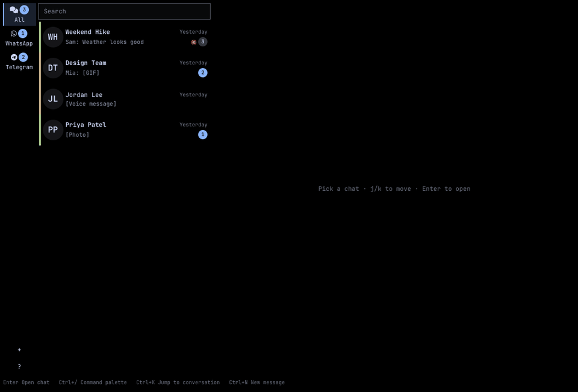
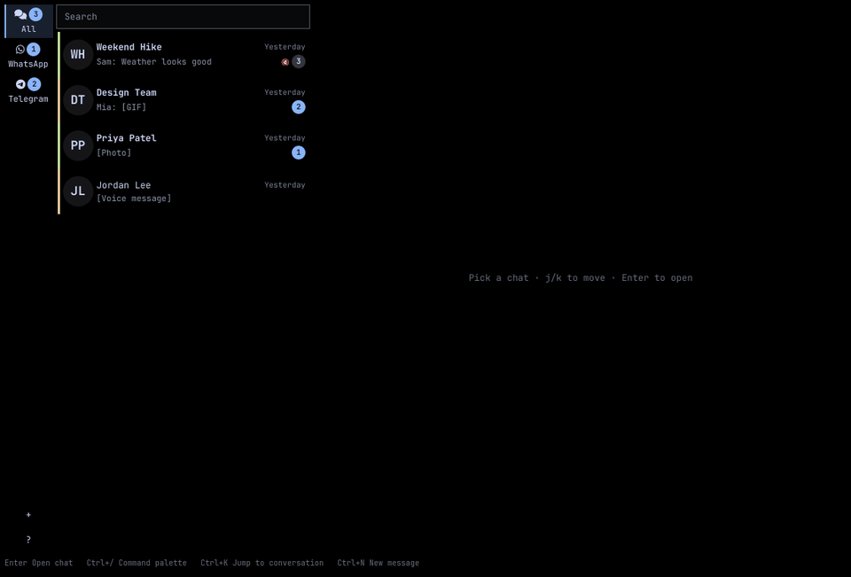

# Demo

Each clip shows one feature, recorded with the test build's sample accounts. `make demo` records them again.

## Unified list and sending

## Keyboard navigation

**Ctrl+J** moves between unread chats, **Alt+↑/↓** between all chats, and **i** / **Esc** switch between writing and scrolling.

## Search

**Ctrl+K** searches every conversation and jumps straight to a message.

## Photos and voice notes

## Replies and reactions

## Editing a message

**Esc** then **E** loads a sent message back into the composer; **Enter** saves the change.

