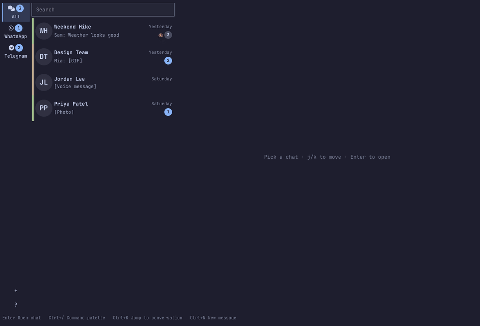
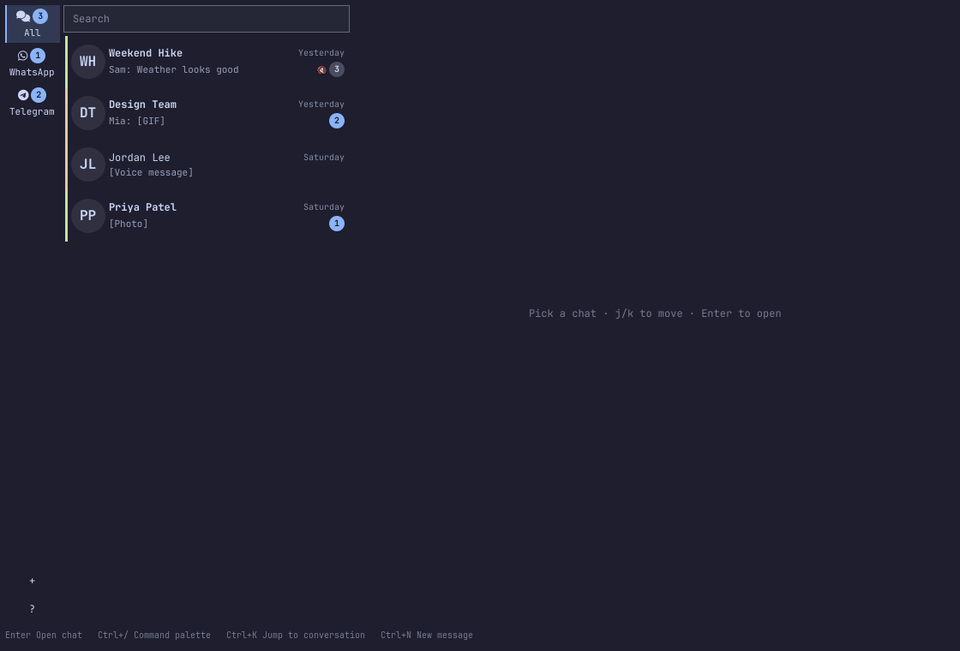
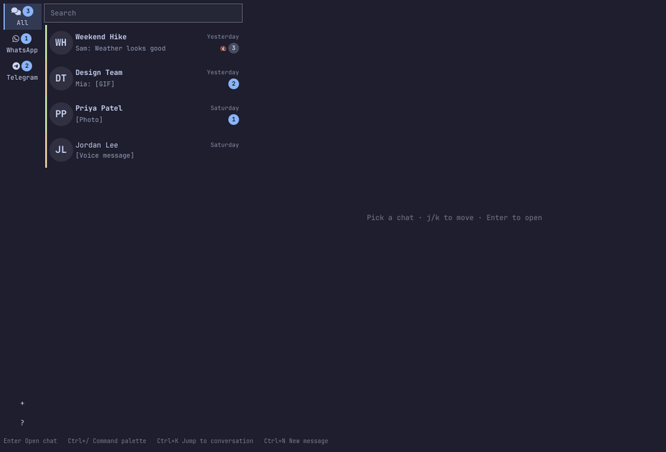
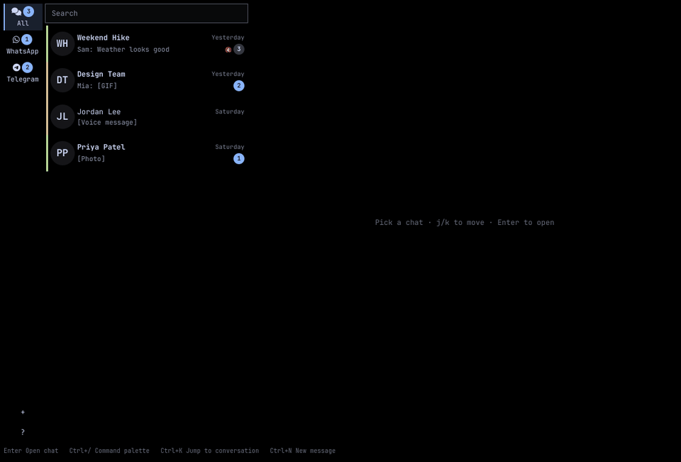
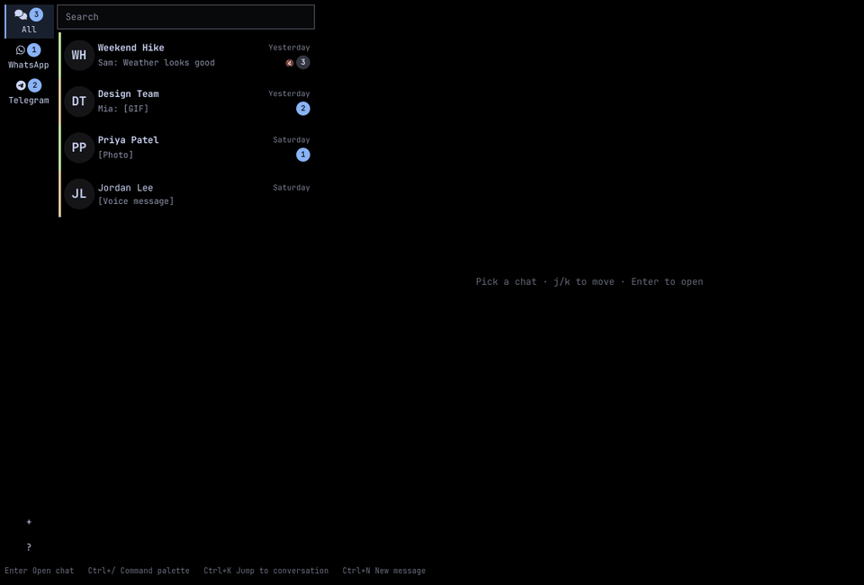
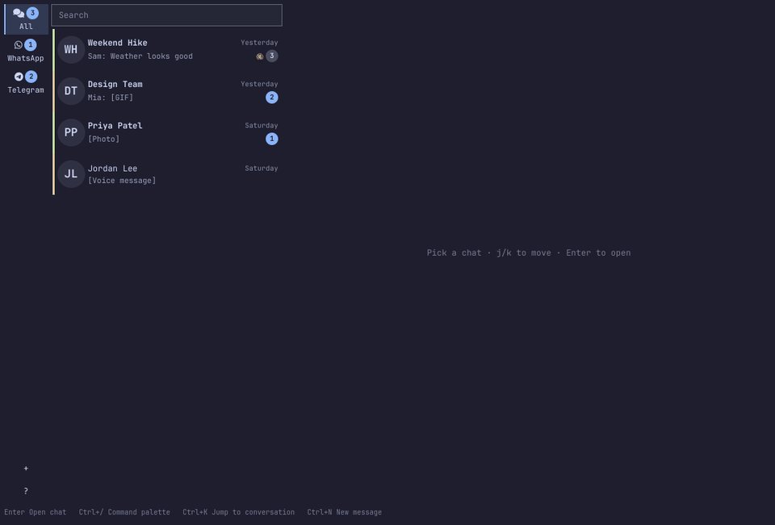

# Demo

Each clip shows one feature, recorded with the test build's sample accounts. `make demo` records them again.

## Unified list and sending

## Keyboard navigation

**Ctrl+J** moves between unread chats, **Alt+↑/↓** between all chats, and **i** / **Esc** switch between writing and scrolling.

## Search

**Ctrl+K** searches every conversation and jumps straight to a message.

## Photos, voice notes and GIFs

## Replies and reactions

## Editing a message

**Esc** then **E** loads a sent message back into the composer; **Enter** saves the change.

## Every action is a command

**Ctrl+/** opens the command palette on every action in the app, not just conversations; typing filters it the same way **Ctrl+K** filters chats.

## Send later

**Ctrl+L** queues the message instead of sending it now; the queued message's "Sends at …" row shows above the composer until it goes.

## Pinning

Pin a chat from the command palette, then **Ctrl+Shift+↑/↓** reorders the pinned chats at the top of the list.

## What's new

The command palette's "What's new" command lists each release's changes in-app; **j**/**k** scroll between releases.

